# Claude Desktop guide

How to give Claude Desktop the safenet-mcp tools: Safenet's staking figures on Ethereum Mainnet,
and its writes as dry runs. The server talks over stdio, so Claude Desktop starts it as a child
process from one entry in its config file.



The session above was recorded with `pnpm --filter @cobuilders/safenet-mcp demo`, against
Mainnet, with the MCP SDK's client making the calls an assistant makes. It shows the server's
answers, not Claude Desktop's window.

## What you need

- Claude Desktop, on macOS or Windows.
- Node.js 22.14 or later.
- An Ethereum Mainnet RPC endpoint. Most tools work with any endpoint. `validators_show` (its
  delegators count), `withdrawals_list` without an address, and `rewards_history` scan the
  chain's history and need an archive endpoint. Without any endpoint, the server uses public
  ones, which refuse those scans.

## 1. Get the server

The package is not on npm yet. Until it is, build it from a clone of this repository:

```sh
git clone https://github.com/CoBuilders-xyz/safenet-staking.git
cd safenet-staking
pnpm install
pnpm --filter @cobuilders/safenet-mcp build
```

This writes `packages/mcp/dist/index.js`, the whole server in one file. Note its absolute path.

Claude Desktop does not read your shell's profile, so a `node` installed by a version manager may
not be on its `PATH`. Find the absolute path of the Node.js you want it to use:

```sh
which node        # macOS
where node        # Windows
```

## 2. Add the server to the config

Open Claude Desktop's settings, then Developer, then Edit Config. That opens
`claude_desktop_config.json`: on macOS in `~/Library/Application Support/Claude/`, on Windows in
`%APPDATA%\Claude\`. Add `safenet` under `mcpServers`:

```json
{
  "mcpServers": {
    "safenet": {
      "command": "/absolute/path/to/node",
      "args": ["/absolute/path/to/safenet-staking/packages/mcp/dist/index.js"],
      "env": {
        "MAINNET_RPC_URL": "<your archive RPC endpoint>"
      }
    }
  }
}
```

On Windows, write each backslash twice in the paths, such as
`"C:\\Program Files\\nodejs\\node.exe"`.

Once the package is on npm, the entry needs no clone:

```json
{
  "mcpServers": {
    "safenet": {
      "command": "npx",
      "args": ["-y", "@cobuilders/safenet-mcp"],
      "env": {
        "MAINNET_RPC_URL": "<your archive RPC endpoint>"
      }
    }
  }
}
```

The config file is plain text. Many RPC providers put the API key in the URL: if yours does, do
not paste the URL here. Start the server through a wrapper that reads the URL from your secret
manager, and point `command` at the wrapper. This one keeps writes off, and loads no signer:

```sh
#!/bin/sh
# safenet-mcp-read: starts safenet-mcp with the RPC URL from the secret manager. Writes stay off.
# Replace <command> with the one that prints the secret.
export MAINNET_RPC_URL="$(<command that prints your RPC URL>)"
exec /absolute/path/to/node /absolute/path/to/safenet-staking/packages/mcp/dist/index.js
```

```json
{
  "mcpServers": {
    "safenet": {
      "command": "/absolute/path/to/safenet-mcp-read"
    }
  }
}
```

Make it executable with `chmod +x`. On Windows, use the PowerShell form at the end of step 5,
without the lines that set `SAFENET_SIGNING_KEY`, `SAFENET_MCP_PRIVATE_KEY_ENV` and
`SAFENET_MCP_ALLOW_WRITES`.

## 3. Restart and check

Quit Claude Desktop completely and open it again. The tools menu in the message box lists
`safenet` with eleven tools: `status`, `validators_list`, `validators_show`, `withdrawals_list`,
`rewards_check`, `rewards_history`, `stake`, `unstake`, `withdrawals_claim`, `rewards_claim` and
`rewards_claim_and_stake`. The README's tools table gives each one's arguments.

If `safenet` is missing or shows an error, read the server's log. Claude Desktop keeps one per
server: on macOS in `~/Library/Logs/Claude/`, on Windows in `%APPDATA%\Claude\logs\`. The server
writes one line when it starts, naming where its RPC endpoint comes from, never the URL:

```text
safenet-mcp: RPC from MAINNET_RPC_URL first, then the public list; writes off, every write is a dry run.
```

A setting it cannot use stops it with exit code 2 and one sentence that names the setting.

## 4. Ask

Questions that use the tools:

- "How much SAFE is staked in Safenet, and does the Merkle root on chain match SEF's?"
- "List the active validators by participation."
- "Can 0x… claim rewards now, and how much?"
- "What would staking 100 SAFE on the first validator from 0x… send?"

Every figure in a result names its source, `chain: Contract.call()` or `SEF: file field`, and
amounts are exact, in wei.

## 5. Writes, only on purpose

Writes are off by default. A write tool then returns a dry run, the transactions it would send
with their gas, and signs nothing; it needs `from`, the address to simulate from. A model cannot
turn writes on.

To allow them, the server must start with `SAFENET_MCP_ALLOW_WRITES=1` and a signer, and no key or
password may sit in the config file. Start the server through a wrapper that reads the secrets
from your secret manager, and point `command` at the wrapper. Use this one only to allow writes;
for the RPC URL alone, use the read-only wrapper in step 2. On macOS:

```sh
#!/bin/sh
# safenet-mcp-writes: starts safenet-mcp with writes allowed. Each secret comes from the
# secret manager; replace each <command> with the one that prints that secret.
export MAINNET_RPC_URL="$(<command that prints your RPC URL>)"
export SAFENET_SIGNING_KEY="$(<command that prints the private key>)"
export SAFENET_MCP_PRIVATE_KEY_ENV=SAFENET_SIGNING_KEY
export SAFENET_MCP_ALLOW_WRITES=1
exec /absolute/path/to/node /absolute/path/to/safenet-staking/packages/mcp/dist/index.js
```

```json
{
  "mcpServers": {
    "safenet": {
      "command": "/absolute/path/to/safenet-mcp-writes"
    }
  }
}
```

On Windows, the same wrapper in PowerShell, saved as `safenet-mcp-writes.ps1`. It was written for
this guide and not run on Windows:

```powershell
# safenet-mcp-writes.ps1: starts safenet-mcp with writes allowed. Replace each <command> with the
# one that prints that secret.
$env:MAINNET_RPC_URL = (<command that prints your RPC URL>)
$env:SAFENET_SIGNING_KEY = (<command that prints the private key>)
$env:SAFENET_MCP_PRIVATE_KEY_ENV = "SAFENET_SIGNING_KEY"
$env:SAFENET_MCP_ALLOW_WRITES = "1"
& "C:\absolute\path\to\node.exe" "C:\absolute\path\to\safenet-staking\packages\mcp\dist\index.js"
```

```json
{
  "mcpServers": {
    "safenet": {
      "command": "powershell.exe",
      "args": ["-NoProfile", "-ExecutionPolicy", "Bypass", "-File", "C:\\absolute\\path\\to\\safenet-mcp-writes.ps1"]
    }
  }
}
```

`SAFENET_MCP_PRIVATE_KEY_ENV` takes the *name* of the variable that holds the key, never the key.
A version 3 keystore works too, with `SAFENET_MCP_KEYSTORE=<path>` and
`SAFENET_MCP_PASSWORD_ENV=<NAME>`. With writes allowed, each write still runs as a dry run first,
and is sent only when the call passes `dryRun: false`. Claude Desktop asks you before each tool
call unless you allow it for the conversation.

## What was checked

On 2026-10-27, with Node.js 22.14.0, the built `dist/index.js` was started exactly as the first
config block starts it, with only `MAINNET_RPC_URL` in its environment. It listed its eleven tools
over stdio, and answered `status` from Ethereum Mainnet at block 26,287,297. Claude Desktop itself
was not part of that check: the machine that ran it has no desktop. The Claude Desktop steps
above, its menus, its log folders and its prompt before a tool call, follow its documentation for
local MCP servers, and may move between its versions.
